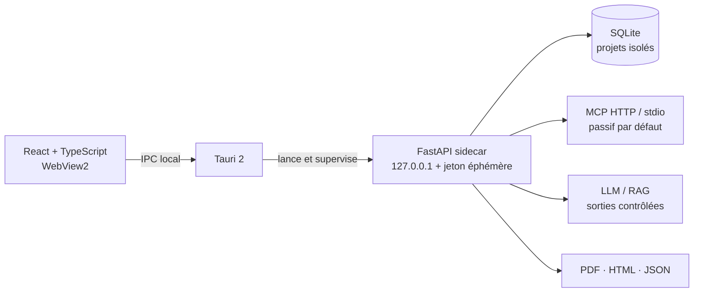

<div align="center">


# AgentSec Inspector

### AI Red Team & MCP Security Auditing Platform

Un poste de travail Windows local-first pour auditer, avec autorisation, les agents IA, serveurs MCP, pipelines RAG et applications LLM.


</div>


<p align="center"><sub>Capture réelle de la V1 exécutée contre le laboratoire contrôlé inclus — aucune donnée fictive n’est injectée dans le dashboard de production.</sub></p>

## Une surface d’audit unifiée

AgentSec Inspector centralise les preuves techniques sans prétendre observer le raisonnement caché des modèles. Les résultats distinguent explicitement une **observation**, un **risque potentiel** et une **vulnérabilité confirmée**.

| Domaine | Capacités opérationnelles |
|---|---|
| MCP Security | Découverte Streamable HTTP/stdio, outils, ressources, prompts, capacités et analyse passive conservatrice |
| Prompt & LLM | 10 scénarios versionnés, OpenAI-compatible, Ollama et endpoint HTTP, statuts PASS/FAIL/INCONCLUSIVE/ERROR |
| RAG Security | Documents et métadonnées, injections contrôlées, traces réelles et parcours Document → Retrieval → LLM → Réponse |
| Agent Behavior | Timeline des messages, appels MCP, paramètres, résultats, erreurs, durées et décisions observables |
| Findings | Cycle de vie complet, historique, preuves, confiance, impact, reproduction et remédiation |
| Reporting | Rapports techniques/exécutifs en français ou anglais, HTML, JSON et PDF |

## Architecture locale sécurisée



- Le backend refuse toute écoute non-loopback et l’API locale exige un jeton transmis par IPC Tauri.
- Les sorties réseau sont protégées contre le SSRF, les redirections sont désactivées et les cibles distantes doivent être explicitement autorisées.
- La découverte MCP n’appelle aucun outil. Les opérations actives nécessitent une confirmation explicite.
- Les secrets de connecteurs sont chiffrés au repos ; aucun token ne doit être placé en clair dans la configuration d’une cible.
- Un échec de transport reste un statut `ERROR`, jamais une attaque réussie.

Le [modèle de sécurité](docs/SECURITY.md) documente les frontières de confiance et les limites d’isolation.

## Démarrage développeur sous Windows

Prérequis : Windows 10 22H2/Windows 11 x64, Python 3.12, Node.js 22+, Rust stable, outils MSVC et WebView2.

```powershell
git clone https://github.com/St0rn/agentsec-inspector.git
cd agentsec-inspector
Set-ExecutionPolicy -Scope Process Bypass
.\scripts\check-prerequisites.ps1 -Development
.\scripts\install-dev.ps1
.\scripts\start-dev.ps1
```

Le laboratoire reproductible et clairement séparé des audits réels se lance avec :

```powershell
.\scripts\start-demo.ps1
```

Pour produire le MSI et l’installateur NSIS x64 :

```powershell
.\scripts\build-windows.ps1
```

Consultez les procédures exactes : [installation Windows](docs/INSTALLATION_WINDOWS.md) · [développement](docs/INSTALLATION_DEVELOPMENT.md) · [build](docs/BUILD_WINDOWS.md) · [dépannage](docs/TROUBLESHOOTING.md).

## Validation observée

| Contrôle | Résultat local |
|---|---|
| Backend | 19/19 tests, 70 % de couverture, Ruff et mypy réussis |
| Frontend | 4/4 tests, ESLint, TypeScript et build Vite réussis |
| Sécurité source/dépendances | `pip-audit` et `npm audit` sans vulnérabilité connue ; Bandit sans finding moyen/élevé |
| Binaire autonome | Build Linux PyInstaller, migration neuve, auth, CORS, intégrité et PDF vérifiés |
| Laboratoire | Découverte MCP réelle (2 outils, 1 ressource, 1 prompt) et échange LLM réel réussis |
| Rust/Tauri | `cargo fmt` et métadonnées verrouillées réussis ; build Windows confié à la CI |
| Windows/PowerShell | Scripts et workflow fournis, mais non validés localement faute d’hôte Windows |

La compilation Windows n’est **pas** déclarée validée sans preuve d’un run Windows. Voir [IMPLEMENTATION_STATUS.md](IMPLEMENTATION_STATUS.md), la [matrice de validation](INSTALLATION_VALIDATION_MATRIX.md) et le [rapport détaillé](docs/VALIDATION_REPORT.md).

## Organisation du dépôt

```text
backend/       API, modèles, migrations, moteurs d’audit et rapports
frontend/      React, TypeScript, Tailwind, graphiques et visualisations
src-tauri/     application desktop, supervision et IPC du sidecar
demo/          laboratoire MCP / LLM / RAG contrôlé
scripts/       installation, build, test, update, backup et désinstallation
docs/          architecture, sécurité et procédures Windows
.github/       tests backend/frontend, sécurité et build Windows x64
```

## Usage autorisé uniquement

Cet outil est conçu pour les audits disposant d’une autorisation explicite et d’un périmètre documenté. Un serveur MCP non fiable doit être exécuté dans une VM ou une Windows Sandbox dédiée : les restrictions du sous-processus stdio ne constituent pas, à elles seules, une sandbox de sécurité.

---

<div align="center"><sub>AgentSec Inspector V1.0 · résultats fondés sur des exécutions et preuves observables</sub></div>
